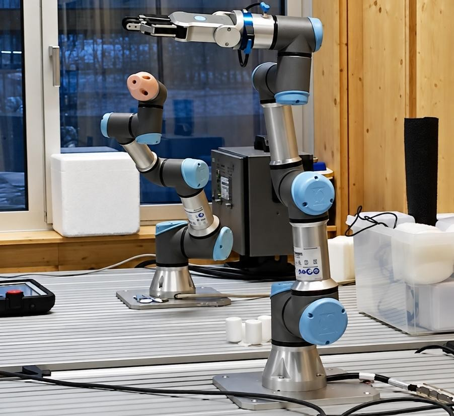
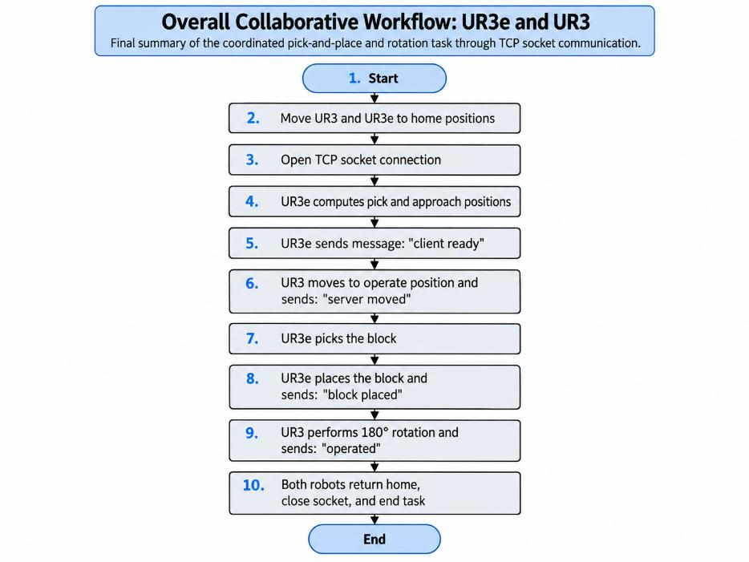
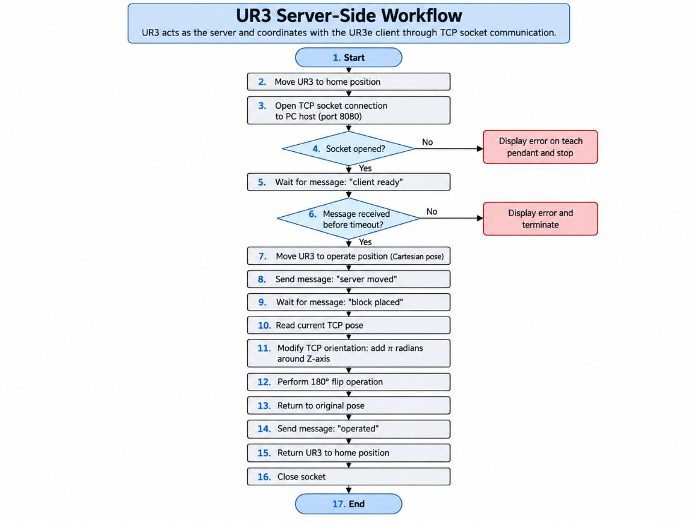
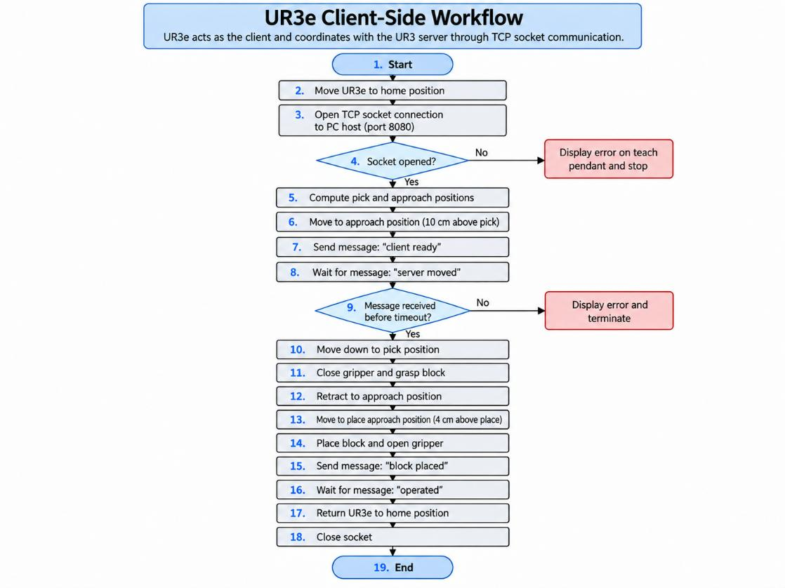

# Collaborative Robotics with UR3 and UR3e

**Multi-robot coordination · URScript · TCP/IP sockets · Pick-and-place · OnRobot RG2**



> Academic Medical Robotics project. The code and report were produced as a team by **David Arias, Carla Berard and Claudia Montero**. This repository documents a laboratory implementation; it is not a ready-to-deploy industrial control system.

## Overview

This project explores coordinated operation of two Universal Robots arms through message-based communication. The **UR3e** picks up a block using its RG2 gripper and places it at a designated location. The **UR3** waits for confirmation, executes a simulated operation by rotating its tool, and sends an acknowledgement. Both scripts synchronize their actions using TCP socket messages relayed through an external Python program running on a PC.

Although the assignment describes the UR3 as the 'server' and the UR3e as the 'client' from a coordination perspective, **both URScript programs are TCP clients** that open a connection to a **PC middleware server**. The middleware was supplied separately during the course and **is not included here**.

## System architecture

```text
             PC middleware / TCP message relay
                       Port 8080
                      /         \
                     /           \
           UR3 (.script)       UR3e (.script)
           secondary operation  RG2 pick-and-place
           tool rotation        block transport
```

The robots do not physically exchange or jointly grasp the same object. The UR3 side simulates its follow-up operation using a tool rotation, as described in the laboratory brief. See [communication protocol](docs/communication-protocol.md).

## Control sequence

1. Both robots move to their configured home positions and connect to the PC relay.
2. UR3e approaches the pick location and sends `client ready`.
3. UR3 moves to its operating pose and responds with `server moved`.
4. UR3e performs a guarded-by-sequence (not force-controlled) pick-and-place using the RG2 gripper, then sends `block placed`.
5. UR3 rotates its tool and returns it to the original pose, then sends `operated`.
6. The robots return home and close their sockets.



## Implementation

| Component | Implementation | File |
| --- | --- | --- |
| UR3 robot | Home/operate poses, TCP message handling, secondary tool motion, acknowledgement | [`ur3_server.script`](ur3_server.script) |
| UR3e robot | Approach poses, RG2 gripper control, pick/place trajectory, TCP synchronization | [`ur3e_client.script`](ur3e_client.script) |
| Communication relay | External Python TCP forwarding program supplied during lab; **not included** | — |

**Robot control:** `movej`, `movel`, `pose_add`, `get_actual_tcp_pose`, `rg_grip`, `rg_payload_set`.  
**Communication:** `socket_open`, `socket_read_string`, `socket_send_string`, `socket_close`.  
**Error handling in original scripts:** connection and acknowledgement timeouts trigger a popup and halt.

### Figures from the report

| UR3 control | UR3e control |
| --- | --- |
|  |  |

## What was learned

The accompanying project report describes experimentation with socket timing, action sequencing, joint configurations and approach poses. The key challenge was ensuring each arm completed its step before the other moved. This exercise demonstrates **multi-agent coordination, industrial robot scripting, network communication and synchronized robotic manipulation**.

## Reproduction and limitations

- **Hardware:** UR3, UR3e and OnRobot RG2 gripper, plus a lab PC acting as the communication relay.
- **Configuration:** Replace the `PC_IP` placeholders in both scripts with the authorized laboratory relay address and provide the compatible PC middleware. Port 8080 must match the middleware configuration.
- **Motion:** The included absolute poses come from a specific lab. **Do not execute them on another robot or workspace without recalibration, collision checks and supervised testing.**
- **No independent verification:** Original report and source programs were reviewed for documentation, but the robots were **not operated or simulated** while preparing this repository.
- **Tool orientation:** The UR3 script modifies the last component of a Cartesian pose rotation vector. That should not be assumed to implement a geometrically exact tool-frame Z-axis rotation in every orientation without further verification.
- **Robustness:** The scripts do not implement reconnection or check the success result of every outgoing socket message. Further validation would be required for real-world deployment.
- **Scope:** This is a laboratory coordination demonstration, **not a clinically validated rehabilitation robot or a certified collaborative safety application**.

See [technical & safety notes](docs/safety-and-reproducibility.md).

## Repository contents

```text
ur3-ur3e-collaborative-robotics/
├── README.md
├── ur3_server.script
├── ur3e_client.script
├── assets/
│   └── figures/
│       ├── robot-lab-setup.jpg
│       ├── ur3-workflow.png
│       ├── ur3e-workflow.png
│       └── overall-workflow.png
└── docs/
    ├── communication-protocol.md
    ├── safety-and-reproducibility.md
    ├── project-report.pdf
    └── portfolio-preview.html
```

**Portfolio preview:** [Open the example project webpage](docs/portfolio-preview.html) (download the repository and open this file in a browser). This is a standalone visual case study, not a deployed website.

## Credits

- **Team:** David Arias, Carla Berard, Claudia Montero
- **Context:** Medical Robotics university laboratory project
- **Source:** Original team URScript files and project report; project brief/instructor material is not redistributed
- **Figures:** From the accompanying team-authored report
